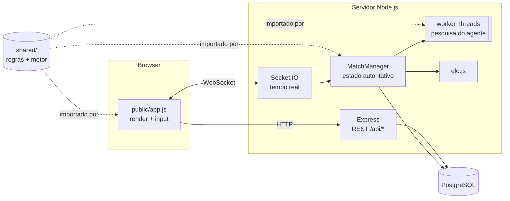

# Arena de Jogos Matemáticos

Plataforma web para jogar os jogos do Campeonato Nacional de Jogos Matemáticos (CNJM) contra
agentes de procura adversa, ou online contra outra pessoa, com ranking ELO persistente e
torneios automáticos entre agentes.

Jogos incluídos: **Dominório**, **Cães e Gatos** e **Rastos**.

## Funcionalidades

- **Contra o agente**: três níveis (Fácil, Médio, Difícil), calculados no servidor.
- **Online contra uma pessoa**: cria uma partida, partilha o código de 5 letras, joga em tempo real.
- **Agente vs agente**: assiste a dois agentes a jogar entre si.
- **Ranking ELO** por jogo (pessoas e agentes) e histórico de partidas em PostgreSQL.
- **Torneio de agentes** por linha de comandos (`npm run tournament`) para avaliação experimental.
- **Servidor autoritativo**: o cliente só envia intenções; o servidor valida a vez e a legalidade de cada jogada.

## Arquitetura



| Pasta | Conteúdo |
|---|---|
| `shared/` | Regras dos jogos e motor de pesquisa. JavaScript puro, usado **no browser e no servidor**. |
| `shared/games/` | Um módulo por jogo, todos com a mesma interface (`init`, `moves`, `apply`, `result`, `evaluate`, `label`). |
| `shared/engine.js` | Negamax com cortes alfa-beta, aprofundamento iterativo e limite de tempo. |
| `server/matches.js` | `MatchManager`: cria partidas, valida jogadas, agenda as jogadas dos agentes, grava resultados e ELO. |
| `server/app.js` | API REST e eventos Socket.IO. |
| `server/ai/` | Corre a pesquisa numa *worker thread* para não bloquear o servidor. |
| `server/db/` | Duas implementações da mesma interface de armazenamento: PostgreSQL e memória. Migrações SQL. |
| `scripts/tournament.js` | Torneio round-robin entre níveis de agente. |
| `public/` | Interface web (HTML, CSS, JavaScript sem framework). |
| `test/` | Testes unitários e de ponta a ponta (`node:test`). |

**Adicionar um jogo** = criar `shared/games/<jogo>.js`, registá-lo em `shared/games/index.js` e
acrescentar o desenho do tabuleiro em `public/app.js` (`UI`). O motor, o servidor e o ranking não mudam.

## Correr localmente

Requisitos: Node.js 20+.

```bash
npm install
npm run dev            # http://localhost:3000, armazenamento em memória
```

Com PostgreSQL via Docker (app + base de dados):

```bash
docker compose up --build   # http://localhost:3000
```

Ou com um PostgreSQL já instalado: copia `.env.example` para `.env`, ajusta `DATABASE_URL` e corre
`npm run dev`. As tabelas são criadas automaticamente no arranque (ou com `npm run migrate`).

## Testes

```bash
npm test
```

Cobrem: regras dos três jogos, o motor (vitórias imediatas, jogadas sempre legais, agente forte vence
o fraco), ELO, o `MatchManager` (vez, jogadas ilegais, desistência, partidas contra agentes) e testes
de ponta a ponta com o servidor real (REST + Socket.IO + workers). O GitHub Actions corre-os em cada
push, mais as migrações e um mini-torneio contra um PostgreSQL real.

## Torneio de agentes

```bash
npm run tournament -- --rounds 10 --time-scale 0.5
npm run tournament -- --game rastos --rounds 20
```

Joga todos os pares de níveis com as duas cores, mostra vitórias/derrotas e o ranking ELO resultante.
Com `DATABASE_URL` definido os resultados ficam guardados.

## Publicar a partir do GitHub (Render)

1. Cria um repositório no GitHub e faz push deste projeto.
2. Em [render.com](https://render.com): **New → Blueprint** e escolhe o repositório.
3. O Render lê `render.yaml`, cria o serviço web e a base de dados PostgreSQL e liga-os.
4. Cada `git push` para o ramo principal volta a publicar automaticamente.

Os planos gratuitos destes serviços mudam com frequência (por exemplo, o servidor pode adormecer
sem uso ou a base de dados gratuita pode expirar); confirma as condições atuais. O projeto também
corre em Railway, Fly.io ou qualquer serviço que aceite um `Dockerfile`: basta definir `DATABASE_URL`
(e `DATABASE_SSL=true` se a ligação for pela internet com TLS).

## API

| Método | Caminho | Descrição |
|---|---|---|
| GET | `/api/health` | Estado e tipo de armazenamento |
| GET | `/api/games` | Jogos, regras e níveis de agente |
| GET | `/api/leaderboard?game=<id>` | Top 20 ELO do jogo |
| GET | `/api/matches?game=<id>` | Últimas partidas terminadas |
| GET | `/api/matches/:id` | Partida guardada, com a lista de jogadas |

Eventos Socket.IO (cliente → servidor, todos com resposta `{ ok, ... }`):
`hello {name}`, `match:create {gameId, mode, side, level, levels}`, `match:join {code}`,
`match:move {id, move}`, `match:resign {id}`. O servidor envia `match:state` a todos os que estão
na partida sempre que ela muda.

## Limitações conhecidas e trabalho futuro

- **Sem autenticação**: o jogador é identificado só pelo nome. Próximo passo: contas com palavra-passe ou OAuth.
- **Partidas em curso só em memória**: se o servidor reiniciar, perdem-se (as terminadas ficam na base de dados).

- Desenvolvido por Anna de Sá Guimarães.
  Para várias instâncias seria preciso Redis e o adaptador Redis do Socket.IO.
- **Motor**: falta ordenação de jogadas nos nós internos, tabela de transposição e heurísticas mais ricas;
  são o ponto natural para a componente de investigação (comparar variantes no torneio).
- **Uma worker por pesquisa**: simples e robusto; com muito tráfego, usar uma *pool* de workers.
- Faltam os restantes jogos do CNJM (Produto, Atari Go, Nex).
